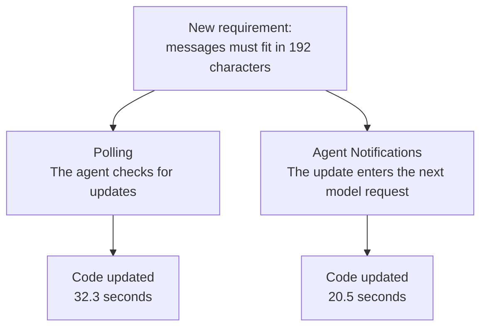

# Agent Notifications

**Give your agent updates while it works.**

Agent Notifications is an experimental runtime extension for AI agents. It delivers CI results, background job updates and messages from other agents directly into the next model request, without a tool call to check for them.

Available today as a **[Pi extension](docs/pi-adapter.md)**.

## See the difference

CI is running while the agent edits another file. An illustrative flow:

| Polling | Agent Notifications |
|---|---|
| “Is CI done?” → Still running. | Keep editing. |
| “Is CI done?” → Still running. | Keep editing. |
| “Is CI done?” → `auth.test.ts failed`. | Receive `CI: auth.test.ts failed` in the next request. |
| Inspect the failing test. | Inspect the failing test. |

**The agent gets the result without asking for it.**

## Try it

Requires Node.js 24+ and a configured Pi installation. Tested with Pi 0.99.2. From this checkout:

```sh
PI_NOTIFY_PORT=8765 pi -e ./src/pi-extension.ts
```

Send an update from another terminal:

```sh
curl -X POST http://127.0.0.1:8765/notify \
  -H 'Content-Type: application/json' \
  -d '{"source":"CI","message":"CI: auth.test.ts failed."}'
```

If Pi is idle, ask it: **“What update did you receive?”** Its next request includes the notification. [Quickstart](docs/quickstart.md) · [Full setup](docs/pi-adapter.md).

For a runnable CI example, start a fresh demo project:

```sh
node demo/ci.mjs launch
```

Pi's task and the CI worker start automatically. While Pi builds a receipt formatter, the worker runs real shipping tests and delivers the failure. Follow the [demo steps](docs/hn-demo.md). The queue delay is simulated; this demonstrates delivery and reaction, not a speed benchmark. [Current limits](docs/limitations.md).

## How it works

1. A script, an MCP bridge or another agent sends an update to `POST /notify`.
2. The runtime saves it for the session and adds it to the next model request.
3. The agent can dismiss it when handled; it stays available in history.

Updates follow the normal agent loop. They do not wake an idle agent or interrupt a running call. [Specification](docs/notification-spec.md).

## Benchmarks

**Get CI results sooner while the agent keeps coding.**

Both agents built real applications while tests ran in the background. One received notifications; the other kept working and checked CI at useful boundaries.

| Measured benefit | Reduction vs adaptive polling | Workload |
|---|---:|---|
| Delay before the model sees CI results | **94.6%** | Catalog CI |
| Requests to the model | **10%** | Catalog CI |
| Manual CI status checks | **50%** | Notes MCP + dashboard |

Median paired reductions, **5 complete correct pairs per workload; 20 successful runs**. Delivery measures identical initial CI results from publication to the first model request containing them.

Small exploratory samples: overall completion time was mixed and total tokens were higher. Earlier CI visibility does not establish faster bug fixing. [Full results](research/ci-comparison-20261007/report.md) · [Methods and evidence](docs/benchmarks.md#readme-summary).

**Earlier pilot: a requirement changes while three agents are coding.**



Observed response to one update; the notification group was interrupted before completion. [Pilot evidence](docs/benchmarks.md#earlier-requirement-change-pilot).

## Next

Pi works today. Codex, DeepSeek and oh-my-pi adapters, relevance filtering and longer benchmarks are planned. [Roadmap](docs/roadmap.md).

[Use cases](docs/use-cases.md) · [Research story](docs/research-story.md) · [All benchmarks](docs/benchmarks.md) · [Interactive report](research/final-20261006/research.html)
