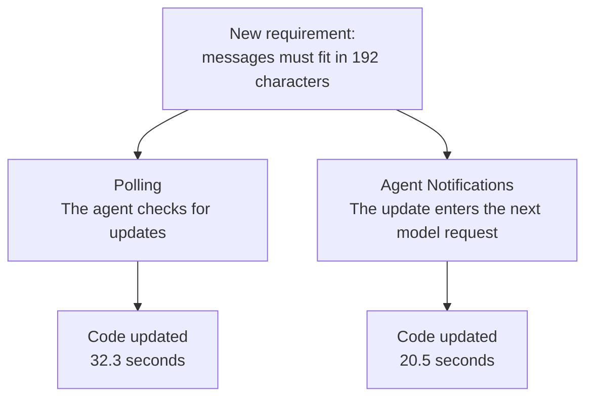

# Agent Notifications

**Give your agent updates while it works.**

Agent Notifications is an experimental runtime extension for AI agents. It delivers CI results, background job updates and messages from other agents directly into the next model request, without a tool call to check for them.

Available today as a **[Pi extension](docs/pi-adapter.md)**.

## See the difference

CI is running while the agent edits another file. An illustrative flow:

| Polling | Agent Notifications |
|---|---|
| “Is CI done?” → Still running. | Keep editing. |
| “Is CI done?” → Still running. | Keep editing. |
| “Is CI done?” → `auth.test.ts failed`. | Receive `CI: auth.test.ts failed` in the next request. |
| Inspect the failing test. | Inspect the failing test. |

**The agent gets the result without asking for it.**

## Try it

Requires Node.js 24+ and a configured Pi installation. Tested with Pi 0.99.2. From this checkout:

```sh
PI_NOTIFY_PORT=8765 pi -e ./src/pi-extension.ts
```

Send an update from another terminal:

```sh
curl -X POST http://127.0.0.1:8765/notify \
  -H 'Content-Type: application/json' \
  -d '{"source":"CI","message":"CI: auth.test.ts failed."}'
```

If Pi is idle, ask it: **“What update did you receive?”** Its next request includes the notification. [Quickstart](docs/quickstart.md) · [Full setup](docs/pi-adapter.md).

For a runnable CI example, start a fresh demo project:

```sh
node demo/ci.mjs launch
```

Pi's task and the CI worker start automatically. While Pi builds a receipt formatter, the worker runs real shipping tests and delivers the failure. Follow the [demo steps](docs/hn-demo.md). The queue delay is simulated; this demonstrates delivery and reaction, not a speed benchmark. [Current limits](docs/limitations.md).

## How it works

1. A script, an MCP bridge or another agent sends an update to `POST /notify`.
2. The runtime saves it for the session and adds it to the next model request.
3. The agent can dismiss it when handled; it stays available in history.

Updates follow the normal agent loop. They do not wake an idle agent or interrupt a running call. [Specification](docs/notification-spec.md).

## Benchmarks

**Get CI results sooner while the agent keeps coding.**

Both agents built real applications while tests ran in the background. One received notifications; the other kept working and checked CI at useful boundaries.

| Measured benefit | Reduction vs adaptive polling | Workload |
|---|---:|---|
| Delay before the model sees CI results | **94.6%** | Catalog CI |
| Requests to the model | **10%** | Catalog CI |
| Manual CI status checks | **50%** | Notes MCP + dashboard |

Median paired reductions, **5 complete correct pairs per workload; 20 successful runs**. Delivery measures identical initial CI results from publication to the first model request containing them.

Small exploratory samples: overall completion time was mixed and total tokens were higher. Earlier CI visibility does not establish faster bug fixing. [Full results](research/ci-comparison-20261007/report.md) · [Methods and evidence](docs/benchmarks.md#readme-summary).

**Earlier pilot: a requirement changes while three agents are coding.**



Observed response to one update; the notification group was interrupted before completion. [Pilot evidence](docs/benchmarks.md#earlier-requirement-change-pilot).

### Latest, longer coding benchmarks

The latest completed application-building trials (October 7–8, 2026) ran for roughly **4–7 minutes**. Catalog CI built a package catalog with an HTTP API and CLI; Notes built an MCP server, SQLite storage and a web dashboard. Both agents kept coding while real tests ran against frozen source snapshots.

| Workload | Strongest measured benefit | Verified task time | Model requests | Token totals: polling → notifications |
|---|---|---:|---:|---:|
| [Catalog CI](research/ci-development-20261007/report.md) | **−94.6% CI result delivery delay** | −3.1% | −10.0% | 892,475 → 1,379,141 |
| [Notes MCP + dashboard](research/notes-mcp-ci-20261007/report.md) | **−50.0% manual CI status checks** | +1.6% | 0.0% | 1,670,035 → 1,844,553 |

Benefits, time and request changes are **median paired percentages vs adaptive polling**. The token column instead sums **five complete runs per mode**, including cached input and output across every request. Each workload has **5 complete correct pairs; all 20 measured runs passed independent acceptance and required CI**. Task time includes final verification.

**Observations**

- **Earlier CI visibility and fewer checks are the clearest benefits.** Catalog's delivery-delay reduction ranged from 90.6% to 97.9% across all five pairs; Notes' manual-check reduction ranged from 50.0% to 100.0%.
- **Completion time remains mixed.** Catalog's paired time changes ranged from −14.2% to +20.0%; Notes ranged from −23.3% to +30.7%. The strongest individual speedups do not represent the cohort as a whole.
- **Token differences varied substantially between runs.** One Notes pair used 6,187 extra cumulative tokens; another used 222,010 fewer. The table measures complete agent workloads, including their different coding and testing paths.
- **Faster delivery does not establish faster bug fixing.** Both modes sometimes repaired code before receiving the old failure; Notes had no actionable current-source failure at first exposure.

### Understanding the token increase

Across the five runs per mode, the extra cumulative tokens were **486,666 for Catalog** and **174,518 for Notes**. These totals repeatedly count conversation history, including input served from cache; they are not the size of an individual update or the amount of newly generated text.

For a concrete single-run comparison, Notes p3 made **20 model requests in each mode**:

| Token component | Polling | Notifications | Difference |
|---|---:|---:|---:|
| Cached input | 170,368 | 246,528 | +76,160 |
| Uncached input | 50,725 | 66,022 | +15,297 |
| Output | 8,619 | 9,242 | +623 |
| **Whole-run total** | **229,712** | **321,792** | **+92,080** |

Most of this difference was **input already served from cache**. Cache reuse across all five Notes runs was 86.2% of input with notifications and 85.5% with polling. Cached input remains in the token counts above; these counts do not establish the change in billed cost.

The current journal keeps previous notification snapshots in later requests to preserve the cache prefix. An active CI result can appear in several snapshots, and dismissal does not erase already delivered history. Notes p3's final request retained **19 earlier snapshots**. Repeated history, plus different coding, test-log and cleanup paths, contributes to the cumulative totals. The study does not isolate a fixed token count attributable solely to a notification.

To illustrate why the base matters: **100 extra tokens** on a 200-token request is **50%**; the same 100 on a 10,000-token request is **1%**. This is an example of scale, not a measured 100-token overhead in these trials. A per-update addition and a full run's repeated, partly cached input are different quantities. [Every pair and the accounting evidence](research/ci-comparison-20261007/token-accounting.md).

These are small exploratory samples, and their duration fell below the intended 10–15-minute target. [Paired comparison and evidence](research/ci-comparison-20261007/report.md) · [Methods](docs/benchmarks.md#ci-while-coding).

## Next

Pi works today. Codex, DeepSeek and oh-my-pi adapters, relevance filtering and longer benchmarks are planned. [Roadmap](docs/roadmap.md).

[Use cases](docs/use-cases.md) · [Research story](docs/research-story.md) · [All benchmarks](docs/benchmarks.md) · [Interactive report](research/final-20261006/research.html)
