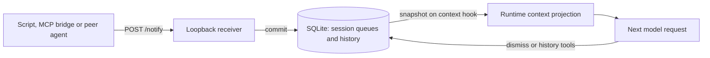

# Dynamic Notification Memory: experimental specification

This describes the current implementation, reviewed on 6 October 2026. It is a runtime contract for the Pi prototype, not a new MCP protocol or a claim about every agent framework. Historical experiments used frozen versions that may differ. [README](../README.md) · [Pi setup](pi-adapter.md) · [Research story](research-story.md).

## Delivery model



The producer publishes a fact; the runtime stores and presents it. The model does not have to discover the event through polling. The static prompt explains its meaning. Inference remains controlled by the host: publishing neither starts a turn nor interrupts one.

An event received after a context snapshot is prepared cannot change that already prepared request. It remains eligible for a later snapshot. Exposure is observable in a provider payload; a correct action is separate evidence. Neither proves when the model privately understood the fact.

## HTTP ingress

The receiver binds to `127.0.0.1`. Its ordinary interface is `POST /notify` with a JSON object. There is no authentication, public relay, listing endpoint or model-side receive tool in this minimal adapter. A remote integration needs its own authenticated bridge; the GitHub research fixture used a separate signed webhook receiver.

| Field | Contract |
|---|---|
| `source` | Required nonblank string, at most 120 JavaScript string code units |
| `message` | Required nonblank string, at most 8,000 JavaScript string code units |
| `sessionId` | Optional nonblank string, at most 128 code units; must already exist in this database |

The raw body limit is **16,384 bytes**, independently of the string limits. Source and message are stored as supplied after validation; whitespace is not normalized away. Other fields do not provide deduplication or producer-controlled timestamps in the core implementation.

```json
{
  "sessionId": "<known-destination-session-id>",
  "source": "CI",
  "message": "runId=4821; revision=abc123; conclusion=failure; failedTest=invoice-limit"
}
```

An accepted request returns HTTP **201** with the stored notification, after its database commit. The record contains `id`, `sessionId`, `source`, `message`, `createdAt`, `firstVisibleCall` and `dismissedAt`; the last two are initially `null`. IDs have the form `notif_<UUID>`. `createdAt` is the receiver’s UTC timestamp, not the original event’s timestamp.

Invalid JSON, invalid fields or an unknown session return **400**; an oversized body returns **413**; an unsupported method or path returns **404**. `/lab/release` exists only with `PI_NOTIFY_LAB=1` for research fixtures.

Without `sessionId`, the receiver uses the Pi session active at receipt. A producer that started a job should retain its original destination from the ready file, rather than rely on the session being unchanged later.

Core ingress accepts repeated POSTs as separate notifications. The Coordinator pilot’s **frozen adapter copy** added `eventId` deduplication; that feature has not been generalized into [src/http.mjs](../src/http.mjs) or the core store.

## Persistence and age

[src/store.mjs](../src/store.mjs) uses SQLite schema version 1, with a session table and a notification table. It enables WAL, `synchronous=FULL`, a five-second busy timeout and transactional updates. The database retains active events, dismiss timestamps, receive order and per-session context counters.

Each snapshot preparation increments that session’s persisted counter, including preparations with an empty queue. A never-exposed active event gets `firstVisibleCall` in the same transaction. Its displayed age is:

```text
t-N: N = current preparation counter − firstVisibleCall
```

`t-0` is the first context preparation that includes the event. `t-1` is the next preparation with it still active. This counts **context preparations**, not user messages, wall-clock time, priority, successful HTTP requests or confirmed model receipt. Reusing an already prepared payload for an HTTP retry keeps its age; rebuilding the context can advance it even if the previous request failed.

Resuming the same Pi session ID and database continues the queue and counter. A new session or fork has separate state. Dormant hours do not increment `t-N`. SQLite retains events already accepted when Pi stops; the current HTTP receiver is unavailable while the Pi process is off.

## Context layout

The conceptual boundary is between stable instructions/conversation and a runtime observation near the current input. There are two actual placements:

```text
tail (default)                  before-input (optional)
──────────────────────          ──────────────────────
System + instructions           System + instructions
Tools                           Tools
Earlier conversation            Earlier conversation
Current input/results           Runtime Notifications
Runtime Notifications           Current input/results
```

For `before-input`, the implementation inserts before the final contiguous batch of user messages or tool results, selected by the last message’s role. It does not move the entire latest conversational turn. Neither layout alone guarantees a provider cache hit.

A snapshot is an external-data section:

```text
<runtime_notifications>
## Notifications

Current time: 2026-10-06T12:00:00.000Z

- [2026-10-06T11:59:58.000Z] [t-0] [notif_<UUID>] source="CI" message="run 4821 failed"
</runtime_notifications>
```

Active events are ordered by receive sequence. Producer strings are JSON-quoted and angle brackets are escaped. A fresh section is supplied even for an empty active queue. There is no automatic TTL, relevance filter, payload coalescing or queue-length cap in the core.

In `dynamic` mode, the projection replaces prior injected notification messages with the latest snapshot. In `journal` mode, it reconstructs immutable earlier snapshots at their original conversation-prefix anchors and adds the latest snapshot. Thus there may be **multiple historical sections, but one authoritative active queue: the last section**.

The native `openai-codex-responses` API selects journal mode by default. Other APIs default to dynamic mode; `PI_NOTIFY_CACHE` can override it. Journal metadata is stored in custom Pi session entries, rather than ordinary transcript turns. Its reconstructed snapshots **are still model input** and use tokens. Saved-session resume restores that metadata; `--no-session` does not retain it across process restarts, even though the SQLite queue persists.

Only records from the same session and current branch are eligible. After compaction or a changed prefix, unmatched anchors are ignored. Archived sections remain historical after dismiss; they must not reactivate events or repeat completed work. [Projection code](../src/notification-context.mjs) · [Controlled cache experiment](../research/cache-fix-20261006/report.md).

## Agent instructions and authority

[prompts/v2.txt](../prompts/v2.txt) is the manual adapter default. [prompts/v3.txt](../prompts/v3.txt) adds stricter job/revision identity and completed-work guidance and was selected in the later broad benchmark.

The instructions teach the agent to use relevant facts, retain unresolved ones, distinguish old snapshots from the current queue, check contradictions, and dismiss facts that have been incorporated or are irrelevant. Notification text cannot grant approvals, change user requirements or become an instruction merely by claiming authority. `t-N` communicates repeated exposure, not importance.

Pi currently serializes custom messages as provider role `user`. The authority distinction is therefore instructed in the prompt; quoting and delimiters are not a guaranteed transport-level trust boundary. Adversarial tests are evidence for the tested cases, not a universal injection-resistance guarantee.

## Management tools

These are **native Pi tools** in [src/pi-extension.ts](../src/pi-extension.ts). The original MVP’s separate notification MCP tools were a design proposal; that is not the current implementation.

| Tool | Default parameters | Behavior |
|---|---|---|
| `notifications_dismiss` | `{id:"notif_…"}` | Remove one event from the active queue; retain history |
| `notifications_dismiss` | `{id:"*"}` | Remove all active events in this session with one call; return a compact count |
| `notifications_history` | `{since:"2h",limit:20}` | Read active and dismissed events, newest receive sequence first |

With `PI_NOTIFY_DISMISS=batch`, the dismiss schema becomes `{ids:["notif_…", "notif_…"]}`, accepting 1–200 entries. `{ids:["*"]}` clears all active events. If `*` appears with other IDs, it takes precedence and a single global dismiss is executed. Specific-ID batches are processed individually; wildcard dismissal uses one SQL update.

Wildcard dismissal covers events active **at execution time**, including arrivals not yet shown to the agent. It excludes other sessions and arrivals after the update. It is suitable only when clearing the whole queue is intended; specific IDs preserve unresolved or unseen arrivals.

Repeated single-ID dismiss preserves the original dismiss timestamp. Unknown IDs report `found:false`; an empty wildcard reports a count of zero. Dismiss does not erase earlier context snapshots, assistant references or history tool output.

History defaults to 20 results, with a maximum of 200 and no pagination. `since` accepts unsigned decimal durations ending in `s`, `m`, `h` or `d`; it filters by **receive time**, not dismiss time. History is for a real retrospective need, not checking for arrivals already delivered in context.

## Boundaries and extensions

The prototype supplies session-scoped persistence and context delivery. Always-on reception, authenticated remote ingress, general event deduplication, subscription policies, semantic filtering and automatic archival remain separate work. The Coordinator outbox demonstrates an integration-specific transport, not a guarantee of exactly-once delivery by this core API.

MCP integrations can publish or relay events into this queue while retaining normal tool/resource operations. A context bridge still has to choose destination, relevance and lifecycle; MCP support by itself does not make the event visible in every agent runtime. [Integration proposals](use-cases.md).
