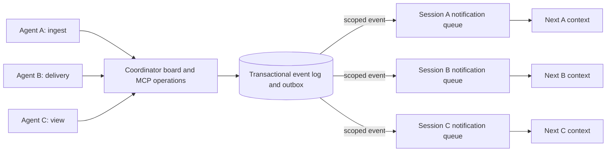

# Use cases and integration sketches

These are the author’s proposed directions, with the evidence level stated for each. The core capability is context delivery at the next natural request; no arrival-triggered inference is assumed. [README](../README.md) · [Specification](notification-spec.md) · [Benchmarks](benchmarks.md).

## Background work with independent next steps

An agent starts several scripts, then edits documentation, another module or tests that do not depend on their results. A worker publishes a concise result when it finishes. The next model request exposes it, allowing the agent to adjust its plan or consume the result without checking every pending job.

```text
Agent: start jobs A/B/C → edit independent module → run its tests → integrate
Worker A: ─────────────── finished ──► notification
Worker B: ─────────────────────────────── failed ──► notification
Worker C: ───────────────────────────────────── finished ──► notification
```

Useful identities include source, job/run ID, revision and destination session. Large logs stay in artifacts. A completed job can matter immediately, only at integration time, or not at all; the agent should not stop unrelated work merely because an event exists.

**Tested:** local subprocess jobs with real file edits, out-of-order completion and failures. Some exploratory comparisons saved model requests and tokens but cost more. **Not established:** a completed 30–60-minute workload that quantifies less rework or a net cost advantage. Once useful work is exhausted and a missing result is required, a wait tool can still be appropriate.

## Agent Coordinator and neighboring files

The author’s Coordinator skill describes a shared activity/message board. The research adapted its real MCP server in an isolated copy, retaining the existing state and conflict-check operations. Notifications can carry scoped activity changes, directed messages and contract revisions while agents work independently.



A practical policy is to subscribe by project, actor and area, exclude self-generated activity changes, and retain directed messages for their recipient. A contract-change event should identify the contract, its revision and the peer or producer that changed it. The recipient can revisit only the relevant work rather than repeatedly listing every activity.

The board is **not an orchestrator**, and an activity is **not a lock**. A “finished” event does not prove no one else is editing. Before an overlapping write, agents still need a current conflict check and a handoff rule. Notification text cannot grant write permission. Directed discussion needs identity, revision handling and loop prevention so repeated peer messages do not create an endless conversation.

**Tested:** the isolated real server, persistent events/outbox, scoped destinations, event deduplication in the frozen transport, and three Pi actors editing nearby modules. A relevant change reached one actor and led to a correct edit without retrieval. **Incomplete:** the N group’s full lifecycle, its efficiency comparison, and the W control. No production installation or upstream skill was modified. [Adapter report](../research/notification-work-pilot-20261006/adapter/report.md) · [Independent action audit](../research/notification-work-pilot-20261006/audit/contract-action-evidence.json).

Future skill refinement should make subscriptions, ownership, current conflict checks, event relevance and final `finish_activity` obligations explicit. Dismissal marks an observation handled; it does not finish a board activity. This is a proposed refinement, not an already published skill update.

## Add context delivery to an MCP server

The adapter pattern is a bridge between a source event and a session-scoped runtime queue. An MCP server or its companion service can retain its existing tool/resource interface and publish updates through that bridge.

```text
MCP server / source service
          │ event or resource change
          ▼
Bridge: subscription + destination + identity + relevance policy
          │ concise fact, optional artifact reference
          ▼
POST /notify → SQLite queue → next agent context
```

This does not require the model to call a retrieval tool for each update. It does require the host to route the event to the right session, handle delivery failures and decide which sources are relevant. A real resource read may still be needed to inspect details or verify a consequential fact; that read remains visible in the metrics.

For a read-only integration, examples include a watched document changing, a review being published or a monitored data resource getting a new revision. Use notifications for the relevant change and retain ordinary reads for details. Automatic subscriptions to every available resource would create noise and are not the intended default.

**Tested:** a controlled MCP-connected fixture sent an unknown fact without any MCP tool call, with a negative ablation; the Coordinator bridge used a real server. **Proposed:** a general bridge for arbitrary MCP resources and servers. This is not a new MCP wire protocol, and no claim is made that event delivery was impossible in other runtimes.

## GitHub Actions while the agent works on a PR

The proposed full workflow is:

```text
Open/update PR at head SHA H → workflow run R starts
              │
              └─► agent continues another permitted task

GitHub event for R/H → authenticated webhook bridge → session queue
              │
              └─► next context: relevant failed check or completed result
```

The notification should carry repository, PR, workflow/run ID, head SHA and conclusion. The agent compares it with its current revision before acting. A result for an obsolete commit is historical information, not a reason to edit the latest code. A failure can trigger inspection when useful; success may need only acknowledgement or dismissal.

**Tested:** real workflow dispatch and signed completion-webhook delivery for success, failure and cancellation, with polling controls. Notification mode did not hide GitHub status polling behind its transport; it could wait for locally delivered events. **Proposed:** opening a PR, continuing a substantial independent task and measuring reaction/rework across revisions. The existing small GitHub demo does not establish that longer scenario’s efficiency.

[GitHub harness](../benchmark/github/run.mjs) · [Workflow fixture](../benchmark/github/bench.yml) · [Results and external API counts](benchmarks.md#github-actions-demonstration).

## Backlog and selective attention

Already accepted events remain in SQLite through idle periods and process restarts. The next normal turn can inspect accumulated facts without a separate retrieval call. This makes a received backlog useful without waking the agent for every arrival.

Receiving new events during hours when Pi itself is off needs an independent always-on receiver, which the core prototype does not yet have. Semantic filtering with Jev is also future work. Both require a policy for preserving important or uncertain events and an auditable history of what was withheld. [Roadmap](roadmap.md).
